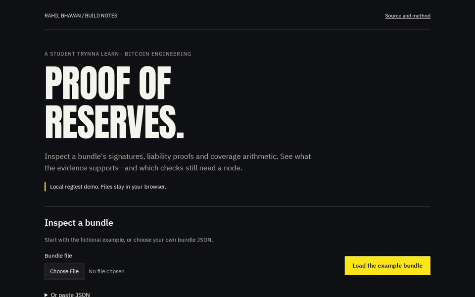

# Treasury proof of reserves: a regtest demo of how a bitcoin-treasury company could prove assets cover its liabilities

A company that holds bitcoin can publish one file that lets anyone check that its coins cover the debts it lists. This repo builds and checks that file for a made-up company on a private test network.

[](https://github.com/RahilBhavan/treasury-proof-of-reserves/actions/workflows/ci.yml) [](LICENSE)

**Live:** https://rahilbhavan.github.io/treasury-proof-of-reserves/



This repository builds and verifies a proof-of-reserves bundle for a fictional bitcoin-treasury company on a local Bitcoin Core regtest node. The asset side is BIP-322 signatures over a challenge that contains a block hash, checked against balances recomputed from the chain at that height. The liability side is a Merkle-sum tree over debt and preferred-stock instruments, with an inclusion proof per instrument. The output is one JSON bundle that a CLI or a static web page verifies, plus a written threat model of what the proof does and does not show.

## What it does

- **Asset proofs.** Signs a challenge (`entity`, `network`, `height`, `block_hash`, `liabilities_root`, `nonce`) with BIP-322 *simple* signatures for P2WPKH and P2TR test addresses. Signatures carry the `smp` prefix from the completed BIP.
- **Balances at a height.** Recomputes each address's unspent balance at height H by scanning blocks 0 to H on a regtest node, so the answer does not depend on the current tip.
- **Liability tree.** Builds a Merkle-sum tree over salted instrument leaves (`convertible_note`, `preferred_stock`, `term_loan`, `other_debt`). Each node commits to both child sums separately. In Maxwell's original summing tree a node committed only to the parent sum, so a prover could report less than the true total ([Hu, Zhang and Guo, 2018](docs/research.md)).
- **Report.** Core report inputs are hash-committed, and the report states whether assets at a stated BTC/USD price are at least the liability total.
- **Verifiers.** A CLI runs all checks against a node. A static page (`web/index.html`, hosted on GitHub Pages) runs the signature, tree, commitment and arithmetic checks in the browser and marks the on-chain checks as skipped.

Example run (`examples/bundle.json`, regtest height 113): 3 addresses holding 22.75 BTC; 5 fictional instruments totalling $2,000,000.00; at a fixed demo price (not a market quote) of $100,000.00 per BTC, assets are $2,275,000.00 and coverage is 113.75%.

## How it works

1. `src/merkleSum.js` builds the liability tree and verifies inclusion proofs.
2. `src/challenge.js` builds and parses the challenge text that every signature signs.
3. `src/bip322.js` wraps `bip322-js` for signing and verifying, and handles the `smp` prefix.
4. `src/prove.js` generates test keys, signs and assembles the bundle.
5. `src/bundle.js` is the verifier. It runs in Node and, bundled by esbuild, in the browser.
6. `src/chain/regtest.js` is a read-only RPC chain source: block hash, tip and balances at a height.
7. `src/cli.js` provides `demo` (fund addresses on regtest, snapshot, sign, write the bundle) and `verify`.

## Run it

Prerequisites: Node.js 26.8.1 or later and, for the chain checks, Bitcoin Core `bitcoind` 31.1 (download provenance in [verification](docs/verification.md)).

```sh
npm ci
npm run check
npm test
```

`npm ci` may warn that esbuild's install script is not approved. The build works without it.

Observed: 46 tests. Without Core, 45 pass and the regtest integration test skips. With a Core 31.1 regtest node running, all 46 pass (run on 2026-10-24, Linux x86_64; see [verification](docs/verification.md)).

End-to-end on regtest (needs Bitcoin Core 31.1; `BITCOIN_BIN_DIR` points at its `bin/`):

```sh
BITCOIN_BIN_DIR=/path/to/bitcoin-31.1/bin npm run regtest:start
npm run demo
npm run verify
BITCOIN_BIN_DIR=/path/to/bitcoin-31.1/bin npm run regtest:stop
```

Offline check, adversarial demo, browser verifier and the Pages build are in [docs/run.md](docs/run.md).

## Repository layout

- `src/` - prover, verifier, Merkle-sum tree, challenge format and the regtest chain source.
- `tests/` - Node test runner suites and the official BIP-322 test vectors (`tests/vectors/`).
- `web/` - the static verifier page; `web/vendor/` is the build output and is not committed.
- `examples/` - fictional liabilities input and a bundle produced by a real regtest run.
- `scripts/` - regtest node control, the adversarial demo, the browser-artifact check and the Pages build.
- `docs/` - research notes, threat model, verification records and the verifier GIF.

## Documentation

- [docs/adversarial-demo.md](docs/adversarial-demo.md) - nine deterministic attack cases, expected verdicts and a five-minute reproduction.
- [docs/run.md](docs/run.md) - offline check, adversarial demo, browser verifier and Pages build commands.
- [docs/README.md](docs/README.md) - index of all documents, including the improvement plan.
- [docs/spec.md](docs/spec.md) - bundle contract, signed fields and supported signature subset.
- [docs/verification.md](docs/verification.md) - reproduced defects, fixes, exact checks and Core provenance.
- [docs/publication.md](docs/publication.md) - publication receipt and remote verification.
- [docs/threat-model.md](docs/threat-model.md) - what a passing bundle proves, what it cannot (borrowed coins, omitted liabilities, price, seniority), and design notes for a zero-knowledge version.
- [docs/research.md](docs/research.md) - cited sources on Merkle-sum trees, BIP-322, PoR weaknesses and what is public about Strategy's custody.
- [DESIGN.md](DESIGN.md) - the browser verifier's visual design system (Rahil Design 3.3.0).

## Sources

- BIP-322 text and test vectors: github.com/bitcoin/bips at commit `130b8e0`, fetched 2026-10-21. The CC0-1.0 vectors are copied unchanged into `tests/vectors/`; their SHA-256 is in [verification](docs/verification.md).
- Chain data: a local regtest chain created by `npm run demo`. No mainnet or signet data is used.
- Liabilities: fictional instruments in `examples/liabilities.json`, shaped like a treasury company's capital stack. They are not Strategy's actual liabilities.
- Background facts (custodians, holdings, Arkham attributions) are cited with dates in [docs/research.md](docs/research.md).

## Scope and limits

- Independent work. Not affiliated with, reviewed by or endorsed by Strategy or Coinbase.
- Demo only: test keys on a local regtest network. Private keys are written to `.regtest/keys.json`, which is git-ignored. Do not use this code with real funds.
- Nothing here proves anything about Strategy. Its cited disclosures (frozen at October 21, 2026) name custodians but list no wallets, and third-party attributions such as Arkham's are not proof.
- The chain source is regtest only. A public signet or mainnet source (an indexer) is not implemented.
- `bip322-js` 4.0.0 is used for P2WPKH (SIGHASH_ALL only) and single-key P2TR. P2WSH, *full* and *proof-of-funds* signatures are not supported. `bitcoinjs-lib` is pinned to 7.0.1 because signing fails with 7.0.4.
- The proof does not detect borrowed coins, omitted liabilities, encumbered coins or a wrong price. See [docs/threat-model.md](docs/threat-model.md).
- At least one liability witness is required to bind the sum to the signed root hash. Leaf count/index are descriptive metadata. Public content hashes are recomputable checksums, not issuer authentication; claimed balances and price are not signed.
- The zero-knowledge version is a design note only.

## License

[MIT](LICENSE). The license covers this project's code only. Fonts in `web/fonts/` keep their own licenses (see `web/fonts/SOURCES.md`).

Part of [Rahil Bhavan's projects](https://github.com/RahilBhavan).
